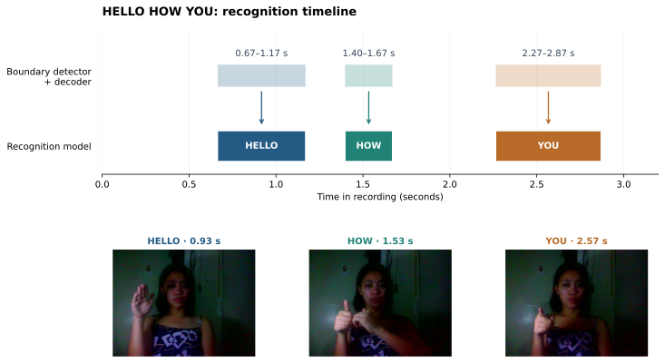

# ATLAS manuscript — exact wording and figure review

Updated: **2026-10-13**. **Development narrative, final-system section, results tables and charts applied to the Page Check tab.**

This revision incorporates fresh, matched current-lineage component evaluations and checks the October 12 deployed recognition configuration against current source/model hashes, fresh validation inference and saved native/phone records. The manuscript “Before” passages remain the exact **October 8 snapshot**, not a claim that the live Google Doc was reread today. [Working manuscript tab](https://docs.google.com/document/d/1sC2JZ23mSpnLWeEEFDm5ce2x_As0XTS7ayMGvk5uuD4/edit?tab=t.8u4bn2h16og9).

Check each proposal independently and write comments under **Your note** using its ID. Unchecked boxes are your review decisions, not failed verification checks. [Previous checklist, preserved in full](review_assets/20261013_verification/README_PLATFORM_NEUTRAL_REVIEW_20261008_archive.md). Slides and the other manuscript tabs remain unchanged. Historical before text remains visible below.

## Applied to Page Check — October 13

- [x] Architecture selection, usage-motivated mild orientation augmentation, and recognition adaptation story.
- [x] Section 4.3.5 **Final System Configuration**: landmark extraction, MobileCLIP2-S0, Squeezeformer recognizer, four-layer Transformer boundary student, segmental decoder, gloss management, T5-efficient-tiny and local speech.
- [x] Five-stage WER: **35.84 → 29.65 → 17.70 → 15.49 → 12.83% retained**. This replaces the earlier branch's 37.61/31.42 proposal.
- [x] Current accuracy, conversion, package size and iPhone 13 frame-processing measurements.
- [x] Component and WER charts, base training curves, removal of the interval combined-loss and obsolete precision charts.
- [x] Native table numbering, figure references and navigation entries updated; rendered pages checked.

**Applied numbering:** Table 11 — base classifiers; Table 12 — recognition components; Table 13 — five-stage WER; Table 14 — unchanged English-output comparison; Table 15 — deployment exports; Table 16 — conversion accuracy. Figures 11–15 are component accuracy, WER development, deployment integration, base training and English training, respectively. Historical “Before” numbering below is preserved.

F-05 is now applied: Figure 2 uses verified midpoint frames from the same development recording as its updated intervals. The local historical manuscript snapshot was not overwritten.

## Proposed development flow

1. **Architecture selection (R-04):** Compare the base Transformer and Squeezeformer classifiers; select the part-wise and global Squeezeformer at 96.83%.
2. **Orientation refinement (R-03a–R-03b):** Explain mild camera-roll augmentation and the adapted landmark model's 95.27% validation accuracy, with the sampled rotation results.
3. **Recognition development (R-03, Table 11, then R-05):** Explain landmark and hand-image inputs, fusion, phrase adaptation, interval adaptation and the current primary recognizer. Follow isolated-sign results with the connected-sign WER story.

## Numerical consistency — current review

**Only the proposed “After” passages and the reporting table below are replacement text.** Historical “Before” excerpts are displayed in full for comparison; their numbers are not current recommendations. They remain exact copies rather than being silently rewritten with measurements they never contained.

| Item | Number to use | Required scope |
|---|---:|---|
| Primary recognition validation accuracy | **95.50%** | Current primary head; PyTorch and FP16 aggregate accuracy |
| Landmark-only validation accuracy | **95.27%** | Current fusion model's standalone landmark parent |
| Hand-image-only validation accuracy | **67.20%** | Current fusion model's standalone hand-image parent |
| Combined-input validation accuracy | **95.40%** | Current-lineage fusion checkpoint |
| Phrase-adapted validation accuracy | **95.22%** | Same lineage and validation membership |
| Interval-adapted validation accuracy | **95.20%** | Same lineage, before subsequent refinements |
| WER development story | **35.84%, 29.65%, 17.70%, 15.49%, 12.83% retained** | Five stages in R-05; experiment and runtime procedures differ |
| Phone processing | **31.14 ms per processed frame** | Current measured iPhone 13 replay configuration |
| Recognizer deployment storage | **26.56 MB** | Current complete FP16 package |
| Flat Transformer base-classifier accuracy | **95.50%** | Original base-study validation inputs; R-04 |
| Flat Squeezeformer base-classifier accuracy | **95.77%** | Same original base-study validation inputs |
| Part-wise/global Squeezeformer base-classifier accuracy | **96.83%** | Same original base-study validation inputs |

The base-classifier values above reproduce the original base-study validation results. Their evaluation membership differs from the current component results in Table 11; they cannot be substituted for final-recognizer accuracy. Current matched MediaPipe stage results, current all-FP32 phone timing and current FP32 package size have **not** been established; omit those comparisons rather than fill their cells with unrelated checkpoints. Existing proposals remove the old extractor-stage table and old Mac timing comparison.

**Lineage correction:** The current primary recognizer descends from the 96.83% part-wise/global base through revised local adaptation, fusion and interval/partial-sign training. It is not descended from the historical full-roll model behind the older 96.30% fusion result. The base model's 96.83% is a base-study score; the new component percentages above use one common admitted validation membership. Keep those scopes explicit. Do not transfer the historical model's full-roll robustness measurements to this lineage.

**Review status:** Changed proposals are reopened below. The separate transition-output accuracy is omitted at the author's request; source evidence remains preserved. All historical excerpts remain visible, and their numbers are historical rather than replacement values.

## Author decision — five-stage development story (October 13)

**Approved terminology:** “evaluation during system development” across all five stages; table title “Recognition Performance Across Development Stages”; metric column “WER (%)”. This does not relabel the recordings as training examples.

The five-stage proposal in **R-05** supersedes the earlier decision to report only 31.42% and keep 12.83% internal. Each stage remains unchecked for wording review. The manuscript is unchanged.

**Preserved author note:** do not put development-set, just say training expreriment

Use “training experiment” when describing stages 1–2, while identifying the evaluation data once. These are not measurements on the training examples themselves. The newly requested training-recording comparison was cancelled at the author's request; its partial results are not paper evidence.

**Your note:**

## Verified measurements and selected reporting scope

| Proposed paper measure | Verified value | What it measures |
|---|---:|---|
| Primary recognition head validation accuracy | **95.50%** | Isolated-sign classification; freshly reproduced in PyTorch and the current FP16 export |
| Five-stage WER proposal | **See R-05** | Training-experiment results and later runtime results, with their procedures distinguished |
| iPhone 13 median processing time | **31.14 ms per processed frame** | Recalculated from the two candidate phone replay runs; includes frame preparation and recognition |
| Current FP16 recognizer package | **26.56 MB** | Recounted complete package bytes; matches the bundled source package |

**Reporting interpretation:** retain 95.50% as the primary recognition component's validation accuracy. Present the five-stage WER story separately in R-05. Its stages do not describe one unchanged checkpoint or decoding procedure; device measurements remain separate. The earlier combined 95.53% / 31.42% / 23.69 ms summary is not reinstated.

## What validation, evaluation and test mean here

**Evaluation set** is a general term, not a synonym for **test set**. Validation/development data support model or setting selection. An independent test set is reserved from those decisions. The figures above are validation/development and engineering measurements, not new independent test results.

Paper prose uses **validation dataset**, **validation accuracy**, and **gloss-sequence WER** with its evaluation scope established, without “pooled,” validation-set sizes or lists of dataset names. Accuracy is total correct classifications divided by total evaluated examples. Audit counts appear only in the review evidence below.

**Preserved by instruction:** existing signer-disjoint discussion, slides, participant plans, schedules, unrelated literature and separately evaluated English-generation results. No new claim that every measurement is signer-disjoint is proposed. General prose remains platform-neutral; measured hardware is attributed explicitly.

## Exact prose and table changes

### R-01 — Define each measurement

- [x] Approve R-01

**Historical before text — reference only**

**Before — manuscript snapshot (October 8):**

> Each comparison retains its own task and measurement conditions. Recognition percentages below describe the corresponding validation studies, while the streaming comparison uses the same recorded sequences for both configurations. Base-classifier CPU timings use prepared inputs; the mobile-device measurements include the stated processing work on the device. Detailed hardware, recording membership and source records are retained in the measurement notes. This separation allows each result to answer the engineering question for which it was measured.

**After — proposed wording:**

> Recognition performance is assessed through isolated-sign classification and connected-sign sequence recognition. Validation accuracy is calculated by dividing the number of correctly classified isolated-sign examples by the total number of examples in the validation dataset. Gloss-sequence word error rate is reported separately through evaluation during system development, with changes in evaluation procedure identified across stages. Device-processing time covers the measured frame preparation and recognition work.

**Review note:** Section 4.4. Avoid a single “system accuracy” label that merges classification, segmentation, English generation and live communication.

**Your note:**

### R-02 — Report the current primary recognition head

- [x] Approve R-02

**Historical before text — reference only**

**Before — manuscript snapshot (October 8):**

> The Apple Vision and MediaPipe pipelines were compared across three recognition stages using the same validation set and vocabulary. The landmark-only base recognizer uses structured movement information. The combined-input recognizer adds hand-image features, while the interval-adapted recognizer is prepared for candidate sign intervals during streaming. Table 11 and Figure 11 compare isolated-sign validation accuracy at these stages.
> 
> The Apple Vision pipeline recorded higher validation Top-1 accuracy at each of the three stages in this comparison. Combining landmark and hand-image features produced 96.30% accuracy for Apple Vision inputs and 94.44% for MediaPipe inputs. After adaptation to candidate intervals, the corresponding isolated-sign validation values were 95.24% and 94.44%. These results describe the evaluated configurations rather than every possible implementation of either extractor.
> 
> Processing speed was measured on the same Apple M4 development computer using identical recordings from the same validation set. Each clip's measured stages were combined: landmark extraction and preparation, applicable hand-image feature extraction, and recognition. Initial video decoding, model loading, English generation, and speech output were excluded. The Apple Vision pipeline recorded median times of 356.1, 668.6, and 668.7 ms per clip for the landmark-only, combined-input, and interval-adapted stages, respectively. The corresponding MediaPipe results were 546.7, 809.3, and 808.6 ms. Figure 11 presents these development-computer measurements alongside recognition accuracy; device processing is evaluated separately.

**After — proposed wording:**

> The current primary recognizer achieved 95.50% validation accuracy within the selected 100-sign vocabulary. Table 12 compares recognition components using the same validation inputs. Landmark-only and hand-image-only recognition achieved 95.27% and 67.20%; combining them achieved 95.40%. Phrase adaptation achieved 95.22%. Two interval fine-tuning variants started from that phrase-adapted checkpoint: the initial interval model achieved 95.20%, while the current primary variant with partial-sign and rejection examples achieved 95.50%.

**Review note:** Fresh inference reproduces this result, including the current FP16 export. It is the original head retained inside the deployed dual-output model, not the earlier 95.53% checkpoint and not the adapted head used alone. This is a proposed wording decision: if you require an accuracy specifically for the complete conditional runtime policy, leave this item unchecked until that distinct evaluation is defined and run.

**Historical before text — reference only**

**Table 11 — before (October 8 transcription):**

| Recognition stage | Apple Vision Top-1 | MediaPipe Top-1 |
|---|---:|---:|
| Landmark-only | 95.77% | 91.80% |
| Combined inputs | 96.30% | 94.44% |
| Interval-adapted | 95.24% | 94.44% |

**After: Table 12. Isolated-Sign Validation Accuracy**

| Recognition component | Validation Top-1 accuracy |
|---|---:|
| Landmarks only | 95.27% |
| Hand images only | 67.20% |
| Combined inputs | 95.40% |
| Phrase-adapted | 95.22% |
| Interval-adapted | 95.20% |
| Current primary recognizer | **95.50%** |

Remove the old extractor-stage comparison and its Mac timings from this passage. Do not reuse those timings for the current configuration.

**Your note:**

### R-02a — Explain the interval-adaptation accuracy change

- [x] Approve R-02a if an explanation of adaptation is included

**Historical before text — reference only**

**Before — proposed insertion:** The older table lists 96.30% combined-input accuracy and 95.24% interval-adapted accuracy without explaining the difference in training objective.

**After — proposed wording:**

> Interval adaptation prepares the recognizer for candidate segments encountered during connected signing. Its development evaluation therefore considers sequence errors as well as recognition of individual signs. Improved sequence recognition does not necessarily produce higher isolated-sign classification accuracy, because the two evaluations measure different aspects of the system.

**Review note:** Phrase-to-interval accuracy changed by only 0.03 percentage points using unrounded results. R-05 now uses the current lineage: phrase-adapted 35.84% and interval-adapted 29.65% under one training-experiment procedure.

**Your note:**

### R-03 — Explain the current recognition method

- [x] Approve R-03

**Historical before text — reference only**

**Before — manuscript snapshot (October 8):**

> Landmarks provided the stronger individual input, reaching 95.50% Top-1 accuracy compared with 80.69% for hand-image features. Combining the inputs reached 96.30%, an increase of 0.80 percentage points over landmarks alone. The improvement supports complementary use of motion and appearance within the recognition component without implying that either input contributes equally.

**After — proposed wording:**

> The combined recognizer was first adapted using individual sign segments from phrase recordings, then fine-tuned on candidate intervals resembling those encountered during streaming. Isolated-sign examples and reference predictions were retained to preserve vocabulary recognition. A further interval-training variant used partial-sign examples and very short fragments to address incomplete gestures and discourage confident guesses. Both interval variants started from the phrase-adapted model. During inference, the boundary detector supplies temporal evidence, the recognizer scores candidate signs, and the segmental decoder selects and accepts the gloss sequence.

**Updated results wording — for Section 4.4:**

> Landmark-only recognition achieved 95.27% validation accuracy, compared with 67.20% for the separate hand-image branch. Combining the two inputs reached 95.40%, an increase of 0.13 percentage points over landmarks alone. The landmark branch represents motion and spatial configuration, while the hand-image branch supplies complementary appearance information.
>
> The combined recognizer was fine-tuned on sign segments from phrase recordings, producing 95.22% isolated-sign validation accuracy. Further fine-tuning on candidate sign intervals produced 95.20%. These adaptations prepared recognition for connected-sign inputs while largely maintaining isolated-sign accuracy. A further interval fine-tuning variant started from the same phrase-adapted checkpoint and incorporated partial-sign examples and training to discourage confident recognition of very short fragments. This variant became the current primary recognizer and achieved 95.50% validation accuracy.

**Review note:** Both interval-training variants start from the phrase-adapted checkpoint. Hand images form a complementary branch, not a later fine-tuning stage.

**Your note:**

### R-03a — Isolated-recognition development story

- [x] Approve R-03a

**After — proposed wording:**

> During use of the model, the researchers observed that signing with the camera slightly tilted could lead to incorrect classifications. Subsequent fine-tuning therefore included mild camera-roll augmentation within ±12°, together with the other landmark augmentations. These transformations exposed the recognizer to small orientation changes while preserving the intended sign labels. The adapted landmark model achieved 95.27% validation accuracy and maintained 94.87–95.32% across the sampled landmark rotations within ±12°.

**Your note:**

### R-03b — Augmentation table

- [x] Approve R-03b augmentation table

**Proposed augmentation-table entries:**

| Augmentation | Applied setting | Intended variation |
|---|---|---|
| Camera roll | Uniform rotation from −12° to +12°; full-roll augmentation disabled | Mild in-plane orientation changes |
| Horizontal mirroring | 50% probability, with left/right anatomical indices exchanged | Mirrored signing inputs |
| Isotropic scaling | 0.88–1.12 times the landmark XY coordinates | Variation in spatial scale |
| Translation | Up to ±0.04 in normalized X and Y coordinates | Variation in position |
| Coordinate noise | Gaussian noise with standard deviation 0.008; 60% trigger probability | Small landmark-coordinate perturbations |
| Temporal warping | Nearest-neighbour resampling with rate 0.82–1.18; 50% trigger probability | Variation in temporal sampling |
| Landmark dropout | Zero 2–6 randomly selected landmark nodes; 25% trigger probability | Missing landmark observations |

**Review note:** Merge these verified landmark augmentations into the existing table. They operate on landmark coordinates, not camera images; each augmentation's individual contribution was not isolated.

**Your note:**

### R-04 — Consolidate architecture evidence

**Revised proposal — original base-study comparison restored:** Use the original base checkpoints and their reproduced base-study validation results. The subsequent adaptation story remains in R-03a; this table does not compare adapted architectures.

- [x] Approve R-04

**Historical before text — reference only**

**Before — manuscript snapshot (October 8):**

> The architecture comparison considered how landmark information should be organized before temporal classification. Table 13 reports earlier design-screening checkpoints; Table 14 reports a separate matched training experiment. Their Squeezeformer results therefore refer to different trained models. Both tables concern landmark-based classifiers and exclude the hand-image encoder and combined recognition model. M denotes millions of parameters, and A flat model processes the input together, part-wise processing first represents anatomical regions, and the graph-part alternative represents connections between landmarks.
> 
> Part-wise and global Squeezeformer processing achieved the highest Top-1 accuracy in this comparison, at 96.83%. Relative to the flat Squeezeformer, the gain was 1.06 percentage points. The selected architecture prioritized the correctness of the first prediction presented by recognition.
> 
> In the matched experiment, Squeezeformer achieved 96.30% validation Top-1 accuracy versus 95.50% for the flat Transformer, a difference of 0.79 percentage points. However, a separate iPhone 13 comparison of the same two classifiers in FP16 measured 0.95 milliseconds for Transformer and 0.99 milliseconds for Squeezeformer. Both retained their original validation predictions. The 0.04-millisecond difference was small relative to variation across four counterbalanced runs. Thus, Squeezeformer provided higher measured accuracy with similar FP16 classifier speed on the evaluated phone. These single-seed accuracy results do not establish general architectural superiority. Classifier timings exclude landmark extraction, hand-image encoding and streaming processing; they are separate from the system's historical 28-millisecond measurement.

**After — proposed wording:**

> In the base validation study, the flat Transformer achieved 95.50% accuracy, the flat Squeezeformer achieved 95.77%, and the part-wise and global Squeezeformer achieved 96.83%. Part-wise and global processing improved accuracy by 1.06 percentage points over the flat Squeezeformer. These results supported selecting this checkpoint for subsequent adaptation. The adapted landmark model's 95.27% validation accuracy is reported separately in Table 12.

**Review note:** Replace historical Tables 13 and 14 with the compact base-classifier table below; its applied number is Table 11. Original base-study scores were reproduced; historical training recipes differ, so these results support checkpoint selection rather than universal architectural superiority. CPU timings remain removed. [Verification](../../artifacts/reports/base_architecture_shared_validation_v17_20261013/REPORT.md).

**Your note:**

**R-04 table replacement — exact content**

**Historical before text — reference only**

Before: **Table 13. Earlier Landmark Architecture Screening** (historical transcription; CPU timing column removed by request).

| Architecture | Parameters | Top-1 | Top-5 |
|---|---:|---:|---:|
| Graph-part replacement | 6.48 M | 78.31% | 95.77% |
| Wider flat Squeezeformer | 14.34 M | 95.24% | 99.74% |
| Flat Squeezeformer | 6.47 M | 95.77% | 100.00% |
| Part-wise + global Squeezeformer | 6.79 M | 96.83% | 99.21% |

Before: **Table 14. Matched Recognition Family Comparison** (historical transcription; CPU timing column removed by request).

| Model family | Parameters | Validation top-1 |
|---|---:|---:|
| BiLSTM | 6.10 M | 89.15% |
| Temporal CNN | 5.90 M | 92.59% |
| Flat Transformer | 6.72 M | 95.50% |
| ATLAS (part-wise + global Squeezeformer) | 6.79 M | 96.30% |

After: **Table 11. Base Landmark Classifier Comparison**

| Classifier | Parameters | Validation accuracy |
|---|---:|---:|
| Flat Transformer | 6.72 M | 95.50% |
| Flat Squeezeformer | 6.47 M | 95.77% |
| Part-wise and global Squeezeformer | 6.79 M | **96.83%** |

“M” denotes millions of parameters. All rows use the original base-study validation inputs. These are base checkpoints before subsequent adaptation, not final ATLAS recognition accuracy. Evaluation membership differs from Table 12. The base training curve in F-03 uses the same original study scope and selected 96.83% checkpoint. No replacement comparison chart is proposed.

**Your note on the updated table:**

### R-05 — Five stages of connected-sign recognition development

- [x] Approve R-05 data description and five-stage table

**Historical before text — reference only**

**Before — manuscript snapshot (October 8):**

> Individual-sign accuracy does not fully describe connected signing, where the system must also decide when a sign begins, ends and becomes stable enough to accept. The streaming comparison therefore measures sequence errors across two complete configurations on the same recordings. Boundary-guided interval classification passes predicted intervals to recognition; ATLAS streaming recognition combines the distilled boundary model, interval-adapted recognition and sequence selection.
> 
> Word error rate decreased from 39.78% to 9.68%, a difference of 30.10 percentage points. This reflects the combined configuration, rather than an isolated effect of boundary distillation. The recordings include familiar-signer and unseen-signer sequences, providing a development comparison of how the system handles connected input. The result supports coordinating interval detection, recognition and gloss commitment instead of judging the streaming workflow solely from individual-sign accuracy.

**After — introductory wording:**

> Evaluation during system development compared each recording's predicted gloss sequence with its reference sequence. Word error rate counts substitutions, deletions and insertions. The same local phrase recordings were used to track the five development stages, with changes in the evaluation procedure identified alongside the results.

**Data note for review:** These are 89 separately evaluated development recordings used for tuning/model selection, not training-example error or an independent final test. [Data and metric verification](../../artifacts/reports/paper_metric_lineage_v17_20261013/REPORT.md).

**After: Table 13. Recognition Performance Across Development Stages**

| Stage | WER (%) |
|---|---:|
| 1. Before interval adaptation | 35.84 |
| 2. After interval adaptation | 29.65 |
| 3. Runtime baseline after intervening data and model refinements | 17.70 |
| 4. Partial-sign training | 15.49 |
| 5. Transition and runtime refinement | 12.83 (retained) |

**Proposed table note:** Results were obtained through evaluation during system development on the same phrase recordings. Stages 1–2 share one evaluation procedure; stages 3–5 use the runtime procedure with subsequent refinements. The table summarizes development stages rather than a controlled comparison of individual changes.

#### W-01 — Before interval adaptation

- [x] Approve W-01

> Before interval adaptation, the phrase-adapted recognizer recorded a WER of 35.84% during system development.

**Note:** Current-lineage epoch-zero baseline: 81 edits / 226 reference signs; development evaluation, not training-example error.

**Your note:**

#### W-02 — After interval adaptation

- [x] Approve W-02

> Fine-tuning the recognizer on candidate sign intervals reduced WER to 29.65% under the same evaluation procedure.

**Note:** Selected epoch four: 67 / 226. Both the initial interval model and the current-primary variant reached this WER from the same phrase-adapted parent. This does not make their runtime behavior identical.

**Your note:**

#### W-03 — Runtime baseline and data review

- [x] Approve W-03

> The runtime baseline integrated the trained recognizer with the distilled boundary detector and segmental decoder, recording 17.70% WER after review of training inputs and model refinements. The change in evaluation procedure means that the difference from 29.65% cannot be attributed to fine-tuning alone.

**Note:** This includes revised training inputs and a changed runtime evaluation procedure. It cannot be attributed solely to corrected annotations or interval adaptation.

**Your note:**

#### W-04 — Partial-sign training

- [x] Approve W-04

> Partial-sign examples were incorporated into recognizer training to address incomplete gestures encountered during connected signing. With the accompanying runtime settings, this configuration recorded a WER of 15.49%.

**Note:** Training and runtime settings both changed. With matched settings, partial-sign training reduced WER from 18.58% to 15.49%.

**Your note:**

#### W-05 — Transition examples and final runtime handling

- [x] Approve W-05

> Further refinement addressed the ordering and acceptance of connected signs, bringing runtime WER to 12.83%. The recognizer was then fine-tuned on transition examples to address the evaluated transition cases while retaining this WER.

**Note:** Ordering and acceptance changes reached 12.83%; transition-example fine-tuning retained that result. The shorter-fragment/rejection variant initially recorded 15.93%, so refinement was not uniformly beneficial.

**Your note:**

#### W-Figure — Optional development visual

- [x] Approve W-Figure, or keep Table 15 alone

**Updated chart preview:**

**Proposed caption:**

> Recognition Performance Across Development Stages. Evaluation during system development used the same phrase recordings, with different procedures for the adaptation experiment and later runtime configurations. Transition-example refinement retained the final measured WER.

**Review note:** Two separate panels identify the procedure change. This is a staged evaluation chart, not an epoch-training curve or a controlled causal improvement curve. The first panel uses the current lineage's training-experiment evaluation; both interval variants reached 29.65%. Detailed intermediate results remain in the linked metric verification report.

[Editable SVG](review_assets/20261013_current_lineage/wer_stages.svg)

**Your note:**

### R-05a — Final System Configuration

- [x] Approved for insertion as Section 4.3.5

**After — exact wording:**

> Following model development and evaluation, ATLAS integrated the selected recognition, boundary-detection and English-generation components into a mobile application. Each component performs a distinct task within the pipeline.
>
> Visual extraction. The landmark extractor obtains structured hand, face and upper-body points from device-camera images. MobileCLIP2-S0 encodes cropped hand images to supply complementary appearance features.
>
> Sign recognition. The final recognizer combines an adapted part-wise and global Squeezeformer landmark branch with a temporal Squeezeformer hand-image branch through a learned fusion classifier. The selected recognizer incorporates interval fine-tuning with partial-sign and rejection examples. Its primary output supplies the reported 95.50% isolated-sign validation accuracy, with transition-refined evidence used selectively for evaluated sign transitions.
>
> Boundary detection. A separate four-layer Transformer predicts whether a frame is outside a sign, at its beginning or within it. It was trained through knowledge distillation from the frozen Sign Language Segmentation teacher. The student operates on landmark features and provides temporal evidence for candidate sign intervals; it does not determine the sign's vocabulary label.
>
> Sequence decoding and gloss management. The segmental decoder combines boundary estimates, recognition scores and movement evidence to select and accept signs. Ordering and acceptance rules support the resulting gloss sequence, which is maintained in the visible gloss buffer. These processing rules are distinct from the trained recognition and boundary models.
>
> English generation and speech. A fine-tuned T5-efficient-tiny model converts accepted glosses into English. Incremental generation prepares output as glosses accumulate and retains completed sentences. The Finish control finalizes the remaining text for display and local text-to-speech output.
>
> On-device execution. The recognition, boundary and hand-image components use FP16 exports. T5-efficient-tiny uses FP32 encoder and decoder exports, which are two computational parts of the same language model. The mobile application connects these components with the device camera and user controls.

**Verification:** Four-layer boundary Transformer: `active/v17/av_boundary_v17.py`; MobileCLIP2-S0: selected native model wrapper; T5-efficient-tiny: current mobile model record. The boundary teacher is an offline training component, not another deployed runtime model. The segmental decoder and gloss manager are processing rules, not separately trained neural models.

**Your note:**

### R-06 — Describe prototype deployment

- [x] Approve R-06

**Historical before text — reference only**

**Before — manuscript snapshot (October 8):**

> The current ATLAS implementation should not, however, be described as a completed production mobile deployment. The evaluated implementation is Mac-based and has been tested using signer-disjoint recorded clips and controlled live testing. The current evaluation does not establish production-level Android or iOS performance, power consumption, thermal behavior, or unrestricted conversational operation.

**After — proposed wording:**

> ATLAS has been implemented as a mobile application and evaluated using recorded inputs on a development computer and an iPhone 13. These measurements establish prototype recognition and device-processing performance within the study’s defined conditions. They do not establish unrestricted conversational operation or performance across all mobile devices.

**Review note:** The normal signed release was installed and launched October 12. Today’s source and package hashes match that deployment record; this is not a new device installation or live device inventory check. Preserve neutral terminology elsewhere.

**Your note:**

### R-07 — State the actual FP16 conversion result

- [x] Approve R-07

**Historical before text — reference only**

**Before — manuscript snapshot (October 8):**

> The FP32 and FP16 recognizer exports were evaluated using the same validation inputs and reference labels. Landmark and cached hand-image inputs were held constant to examine the recognizer's predictions separately from changes in visual extraction. The comparison found similar recognition accuracy, while the device evaluation examined the processing cost of each precision configuration.
> 
> The FP32 recognizer recorded 95.24% validation Top-1 accuracy, compared with 94.97% for FP16. Top-5 accuracy was 98.94% for both. These values describe the interval-adapted recognizer, whereas the model-family comparison reports separately trained configurations.

**After — proposed wording:**

> The FP16 recognizer export was evaluated using the same prepared landmark and hand-image inputs as the trained model. The primary recognition head retained 95.50% validation accuracy after conversion, although one predicted label changed. Equal aggregate accuracy therefore did not imply identical predictions for every input.

**Review note:** Fresh complete admitted-validation inference was run for both heads. Primary head: 3,779 correct in both implementations, with 3,956/3,957 top-1 agreement. Do not claim zero conversion impact across the whole recognizer. A matched all-FP32 mobile pipeline was not built or timed in this audit.

**Historical before text — reference only**

**Before — Table 18 recognition rows:**

| Measure | FP32 | FP16 |
|---|---:|---:|
| Validation Top-1 accuracy | 95.24% | 94.97% |
| Validation Top-5 accuracy | 98.94% | 98.94% |

**After — proposed compact conversion table:**

| Component | Trained model (FP32) | Deployment export (FP16) |
|---|---:|---:|
| Primary recognition head validation accuracy | **95.50%** | **95.50%** |

These columns compare the trained PyTorch model with its export, **not two complete mobile precision configurations**. Omit the old Top-5 row. The table is scoped to the primary recognizer. The separate transition-output percentages are omitted by author instruction; this does not establish identical conversion behavior for every output.

**Your note:**

### R-08 — Use the current package size

- [x] Approve R-08

**Historical before text — reference only**

**Before — manuscript snapshot (October 8):**

> Model sizes compare saved FP32 inference weights with complete FP16 deployment packages, in decimal megabytes. They describe model storage rather than working memory or the size of the complete application.

**After — proposed wording:**

> The FP16 recognizer deployment package occupies 26.56 MB. This value measures the complete recognizer package in decimal megabytes, rather than working memory or the size of the complete application.

**Review note:** Recounted 26,557,148 bytes, excluding filesystem AppleDouble metadata. Package file hashes match the mobile source bundle. Old 25.51 MB and 50.28 MB packages belong to an earlier model. There is no verified matching FP32 package size for this dual-output recognizer in this review.

**Historical before text — reference only**

**Before:** recognizer saved model size 49.62 MB / 25.51 MB; boundary size 9.25 MB / 4.68 MB.

**After — current deployment entry:**

| Component | Precision | Deployment package size |
|---|---|---:|
| Recognizer | FP16 | **26.56 MB** |

Remove the boundary storage row from the recognizer table; retain the boundary component in methodology. A new matched FP32 storage column remains pending if you want to retain that comparison.

**Your note:**

### R-09 — Use the verified current phone measurement

- [x] Approve R-09

**Historical before text — reference only**

**Before — manuscript snapshot (October 8):**

> On the iPhone 13, the current FP16 visual and recognition configuration recorded 24.1 ms per processed frame, compared with 112.6 ms for the corresponding FP32 configuration. Both used identical recorded inputs, and English generation remained FP32 and outside the timed work. The reported values are the medians of two run medians per configuration. Figure 13 compares these integrated configurations; the difference should not be attributed to numerical precision alone. Timing includes frame preparation and recognition, rather than camera capture or complete English and speech output.

**After — proposed wording:**

> On iPhone 13, the evaluated configuration recorded a median processing time of 31.14 ms per processed frame during two camera-paced replays of a development recording. Timing covered frame preparation, landmark and hand-image processing, and recognition. Camera capture, model loading, interface presentation, English generation and speech output were outside the timed work. This measurement describes frame computation rather than the delay before a gloss is displayed.

**Review note:** Recalculated across 1,041 frame measurements in the two candidate runs; this is not a median of two medians. The 95th percentile is 57.85 ms. English was resident, but its generation was not timed. The runs processed one known recording and do not establish sustained thermals or fresh-signer accuracy. No historical-versus-current timing comparison is proposed. The 31.14 ms includes more than recognizer inference, so do not label it “per-clip inference.”

**Optional table if needed; no new bar chart:**

| Device | Median processing time | Measurement scope |
|---|---:|---|
| iPhone 13 | **31.14 ms per processed frame** | Camera-paced recorded-input preparation and recognition |

Remove the old 24.1/112.6 ms comparison and the earlier proposed 23.69 ms. A current all-FP32 versus all-FP16 phone comparison remains unmeasured.

**Your note:**

### R-10 — Practical interpretation of validation accuracy

- [x] Approve R-10

**Historical before text — reference only**

**Before — manuscript snapshot (October 8):**

> The study therefore evaluates the performance of the developed system only within the defined ASL vocabulary and testing conditions. Recognition of signs outside the selected vocabulary, other ASL expressions, full ASL grammar, Filipino Sign Language, or other sign languages is outside the scope of the present study.

**After — proposed wording:**

> The study therefore evaluates the performance of the developed system only within the defined ASL vocabulary and testing conditions. Recognition of signs outside the selected vocabulary, other ASL expressions, full ASL grammar, Filipino Sign Language, or other sign languages is outside the scope of the present study.
> 
> Isolated-sign validation accuracy measures classification of prepared sign inputs. During live use, the system must additionally locate sign boundaries and maintain a sequence of recognized signs. Consequently, isolated-sign validation accuracy does not represent end-to-end communication accuracy.

**Note:** Append this paragraph to Section 1.4 without rewriting the existing signer-disjoint discussion or participant-research provisions.

**Your note:**

### R-11 — Explain transition handling without low-level settings

- [ ] Approve R-11

**Historical before text — reference only**

**Before — proposed insertion:** The October 8 checklist had no explanation of the newly deployed auxiliary transition head and scoped boundary correction.

**After — proposed wording:**

> Closely connected signs can cause the movement of one sign to enter the recognition window of the next. ATLAS supplements its primary recognition output with an adapted transition head while retaining the primary model’s outputs. The decoder uses this evidence selectively with observed hand contact, motion and the following gesture to refine candidate intervals. This addresses the evaluated transition cases without applying the adapted head as a replacement for every recognition decision.

**Review note:** Optional explanatory paragraph after R-03 if that paragraph alone is too brief. Avoid duplicating the two. Current evidence supports the targeted MY transition repair; it does not establish that all coarticulation errors or HAVE omissions have been resolved. Keep training-arm counts, thresholds, thread settings and processor flags out of the manuscript.

**Your note:**

## Charts, figures and exact captions

All before images are the October 8 manuscript snapshots. Updated component, WER and base-training charts have been inserted in Page Check. The combined-loss chart remains supporting material only.

### F-01 — Replace the outdated pipeline comparison (current Figure 11)

- [x] Approve F-01

**Historical before text — reference only**

**Before — manuscript snapshot (October 8) image:**

**After — replacement preview:**

**After caption:**

> Recognition Component Validation Accuracy. All components from the current recognizer's lineage were evaluated on the same validation inputs. The chart compares isolated-sign classification; it does not measure complete live communication accuracy.

**Review note:** Replaces the outdated extractor/timing figure. Table 11 contains the exact same numbers. Later refinements are represented by the current primary recognizer, without a separate transition-output bar.

[Editable SVG](review_assets/20261013_current_lineage/component_accuracy.svg)

**Your note:**

### F-02 — Remove the old phone precision chart (current Figure 13)

- [x] Approve F-02

**Historical before text — reference only**

**Before — manuscript snapshot (October 8) image:**

**Before caption:** “Figure 13. On-Device Processing by Precision”

**After:** Remove the chart and caption. Replace the adjoining paragraph with R-09’s exact wording; report **31.14 ms per processed frame** once in the final device-performance results.

**Your note:**

### F-03 — Retain a clearly identified base-classifier training curve

- [x] Approve F-03

**Historical before text — reference only**

**Before — Figure 14:**

**Before caption:** “Figure 14. Landmark Recognition Training”

**Before discussion:**

> Figure 14 shows landmark-recognition training across the recorded epochs. The selected checkpoint at epoch 100 achieved 96.83% validation Top-1 accuracy. Selection follows validation behavior rather than assuming that the final recorded epoch must provide the best recognition.

**After — regenerated from the saved base-training history:**

**After caption:**

> Figure 14. Base Landmark Classifier Training. Recorded training and validation loss are shown alongside base-study validation accuracy. The selected checkpoint at epoch 100 achieved 96.83% in that evaluation.

**After discussion:**

> The base landmark classifier improved over the recorded training epochs, with checkpoint selection based on validation performance. This checkpoint supplied the starting model for the current training lineage. Its base-study accuracy is distinct from the subsequently adapted components evaluated together in Table 12.

**Review note:** Uses all 130 recorded epochs; selection remains epoch 100. This is the actual ancestor, not the historical full-roll model. No synthetic points or new training were used. The validation curve retains its original base-study membership and must not be relabeled as the final shared-validation accuracy.

[Editable SVG](review_assets/20261013_current_lineage/base_training.svg)

**Your note:**

### F-04 — Remove the combined-loss curve from the main paper

- [x] Approve F-04 — retain training records as supporting evidence

**Before — historical manuscript image:**

**After:** Remove the interval-training figure and its caption from the main paper. Retain the base training curves and five-stage WER chart.

**Replacement discussion:**

> The current primary recognizer underwent eight planned epochs of interval fine-tuning with partial-sign and rejection examples. Epoch 4 was selected because it first achieved the lowest development WER while meeting isolated-recognition accuracy requirements; later epochs matched that WER. Selection therefore considered sequence performance and recognition retention rather than training loss alone.

**Supporting record — visible for review, not for insertion into the paper:**

The combined loss contains classification, uncertainty and retention terms. Its numerical scale is not comparable with the base classifier's loss. This is the later interval/partial-sign variant, not a common training curve for every adaptation stage.

[Editable SVG](review_assets/20261013_current_lineage/current_training.svg)

**Your note:**

### F-05 — Update HELLO HOW YOU from an actual new recognition trace

- [x] Approve rerun and replacement F-05

**Historical before text — reference only**

**Before — existing timeline asset:**

**Before — exact current discussion:**

> The HELLO HOW YOU example in Figure 2 illustrates how the boundary and recognition components relate to a recorded sequence. The upper row shows selected intervals based on boundary estimates and decoder decisions, while the lower row associates those intervals with the recognized glosses. HELLO occupies approximately 0.67–1.17 seconds, HOW 1.40–1.67 seconds, and YOU 2.27–2.87 seconds in the saved recognition record. The video stills show one original frame near the midpoint of each interval, providing a visual reference for the signing input.

**After — applied replacement with matching signer frames:**

**After caption:**

> Figure 2. HELLO HOW YOU Recognition Timeline

**After discussion:**

> The HELLO HOW YOU example in Figure 2 illustrates how the boundary and recognition components relate to a recorded development sequence. The upper row shows selected intervals based on boundary estimates and decoder decisions, while the lower row associates those intervals with the recognized glosses. HELLO occupies approximately 0.87–1.80 seconds, HOW 2.07–3.00 seconds, and YOU 3.17–4.57 seconds in the saved recognition record. The video stills show one original frame near the midpoint of each interval, providing a visual reference for the signing input.

**Verification:** Development case `022d8f1f67a525ad4ea7` maps to `local:HELLO_HOW_YOU:00424e11`. The source video hash matches the calibration manifest. Unmodified source frames 40, 76 and 116 were extracted at 1.33, 2.53 and 3.87 seconds, near the midpoint of each saved interval. The figure separates selected intervals (boundary + decoder) from recognized glosses (recognizer + decoder). No new inference or protected-test access.

[Editable SVG](review_assets/20261013_hello_source/hello_timeline_with_frames.svg) · [Frame provenance](review_assets/20261013_hello_source/frames.json) · [Saved recognition output](review_assets/20261013_verification/hello_trace.json)

**Your note:** still put the boundary + decoder and the recognition model and the images of the signer

**Completed:** both processing rows and matching signer images are included.

### F-06 — Renumber and preserve unrelated material

- [x] Approve F-06

**Historical before text — reference only**

**Before:** Existing figures/tables and their navigation entries still reference the proposed removals.

**After:** Renumber surviving tables and figures, update all in-text references and refresh the lists of figures/tables after approved changes. Figure 14/Figure 2 above are current identifiers, not a promise of final numbering. Keep the English-output table and training figure, boundary-model explanation, schedules, participant plans and other tabs unchanged.

**Your note:**

## Optional summary sentence

- [ ] Approve S-01

**Historical before text — reference only**

**Before — October 8 proposal:**

> The final ATLAS recognizer achieved 95.53% validation accuracy on the validation dataset and a development-set gloss-sequence word error rate of 31.42%. The evaluated FP16 configuration required a median processing time of 23.69 ms per frame on iPhone 13 for preparation and recognition.

**After:**

> The current primary recognition head achieved 95.50% isolated-sign validation accuracy. In the interval-recognizer training experiment, WER decreased from 35.84% to 29.65%. Separate runtime evaluation recorded 17.70% at baseline and 15.49% with the partial-sign configuration; subsequent runtime refinements achieved 12.83%, which was retained after transition-example fine-tuning. Device evaluation of the current configuration recorded a median frame-processing time of 31.14 ms on iPhone 13 for preparation and recognition.

**Review note:** This sentence preserves the different measurement scopes. It does not call 95.50% the accuracy of complete live communication, claim a phone-measured WER, or imply that the training-experiment WER and current deployment describe one unchanged configuration. Use only if the component-level accuracy presentation in R-02 is accepted.

**Your note:**
do not include the separate runtime evaluation anymoe. lets just stick to one timeline
## Verification record — evidence, not manuscript prose

Fresh checks on October 13:

- Current decoder, model loader, project configuration and test-source hashes match the October 12 deployment record. All candidate-manifest pinned file hashes checked today match. This confirms local source/artifact identity, not the phone’s present running state.
- Fresh original and adapted head inference used the admitted validation features with the established identity exclusions; no new split, training or protected-test inference.
- Fresh FP16 inference used the corresponding raw validation inputs in the same admitted order. The package bundled in mobile source matches the verified export byte-for-byte.
- The later decoder-development WER was recalculated from saved native hypotheses and references: 29/226 = 12.83%. This is now included in the five-stage R-05 proposal, explicitly retained after transition-example fine-tuning. No newly generated hypotheses were substituted.
- Phone timing was recalculated from raw frame measurements; no new phone benchmark was run.
- The HELLO preview was generated from a saved current-decoder development record and visually checked.

| Head and implementation | Correct / evaluated | Validation accuracy | Top-1 agreement with PyTorch |
|---|---:|---:|---:|
| Primary head, PyTorch FP32 | 3,779 / 3,957 | 95.50% | Reference |
| Primary head, deployed FP16 export | 3,779 / 3,957 | 95.50% | 3,956 / 3,957 |

These counts are internal review evidence, not proposed validation-set sizes for the manuscript. The two heads are not independent models whose accuracies should be averaged. Conditional runtime behavior is evaluated separately through development sequence outputs.

**Remaining gaps — explicitly not verified by this update:**

- [ ] V-01 — If retained, build and evaluate a matching **current all-FP32 mobile configuration** for speed and package comparison. Today’s FP32 reference is PyTorch, not an all-FP32 phone deployment.
- [ ] V-02 — If an overall conditional-runtime isolated accuracy is required instead of R-02’s component result, define the exact input/segmentation protocol and evaluate it. Do not substitute the auxiliary-head percentage.
- [ ] V-03 — If video stills are wanted in F-05, identify and verify the replacement example’s own source frames before adding them.
- [ ] V-04 — Before applying the checklist, reread the live manuscript tab and reconcile any author edits since the October 8 snapshot.

No fresh independent signer accuracy, sustained thermal test, updated English-quality evaluation or complete end-to-end communication score was produced. Existing limitations are not erased by targeted development replay success.

## Evidence

- [Fresh base architecture evaluation on shared validation](../../artifacts/reports/base_architecture_shared_validation_v17_20261013/REPORT.md)

- [Fresh matched current-lineage component evaluation](../../artifacts/reports/current_lineage_components_v17_20261013/REPORT.md)
- [Checkpoint ancestry verification](../../artifacts/reports/paper_checkpoint_lineage_v17_20261013/REPORT.md)
- [Chart sources](review_assets/20261013_current_lineage/sources.json) · [Chart generation script](review_assets/20261013_current_lineage/generate.py)

- [Selected training experiment: recorded history](../../artifacts/reports/canonical_recognition_comparison_v17_20261007/downstream_recipe/chain_9683/span_recognizer/history.json)
- [Training-experiment claim verification](../../artifacts/reports/canonical_recognition_comparison_v17_20261007/PAPER_CLAIM_REVIEW.md)

- [October 13 verification: hashes, fresh head inference, conversion, WER and timing](review_assets/20261013_verification/verification.json)
- [Current deployed transition-repair report](../../artifacts/reports/my_transition_recovery_v17_20261011/REPORT.txt)
- [Deployment and cleanup-parity record](../../artifacts/reports/my_transition_recovery_v17_20261011/deployment/REPORT.txt)
- [Saved development predictions](../../artifacts/reports/my_transition_recovery_v17_20261011/merge_validation.json)
- [Development case identities and roles](../../artifacts/reports/my_transition_recovery_v17_20261011/joint_validation_cases.json)
- [Current head-training results](../../artifacts/reports/my_transition_recovery_v17_20261011/confidence_training_results.json)
- [Phone benchmark scope and measurements](../../artifacts/reports/my_transition_recovery_v17_20261011/phone_comparison_summary.json)
- [Base-classifier comparison record](../../artifacts/reports/canonical_recognition_comparison_v17_20261007/REPORT.md)

The review does not apply changes to the manuscript, slides or production application. It preserves prior evidence rather than overwriting historical results.
